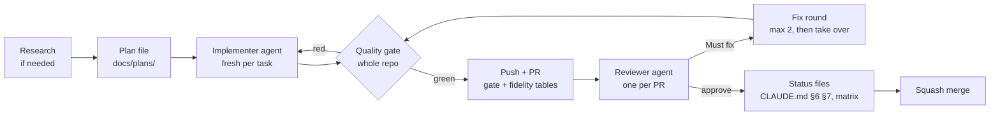

# ai-dev-workflow

**A Claude Code skill that makes AI agents ship code the way a careful senior team does.** One agent plans, a
separate agent writes the code, a hard quality gate checks the whole repo, and a third agent, which never saw the
plan, reviews the pushed PR. Screens are checked pixel by pixel against the design with golden tests. Every step
is written down in the repo, so any new session can pick up exactly where the last one stopped.

```sh
curl -fsSL https://raw.githubusercontent.com/eslamnegm010/ai-dev-workflow/main/install.sh | bash
```

Then open Claude Code in any repository and say: **"set up the AI dev workflow here"**.

---

## Why

AI agents write a lot of code quickly. Without a process they also guess at missing specs, approve their own work,
"fix" failing tests by weakening them, drift from the design, and forget everything when the context is compacted.
This skill turns the habits that stop that into a repeatable loop with gates, templates and tested scripts.

| Problem | What the workflow does about it |
|---|---|
| The agent invents behaviour, copy or pixels | **Translate, don't invent.** Every gap becomes a logged *discrepancy* with options and a recommendation. The owner decides product questions; small technical gaps are decided and marked "delegated" |
| The same agent writes and approves the code | **Three separate roles.** The planner, the implementer (a new instance for every task) and the reviewer (one instance per PR, reading only the pushed diff) |
| "All tests pass" when they don't | **The main session re-runs the gate itself** and never trusts a reported result. The gate covers the whole repo before every push, PR and merge |
| Tests edited until they go green | **Never edit a test just to make it pass.** Key tests are *mutation-checked*: break the code, watch the test fail, restore |
| The UI drifts from the design | **Golden tests against captured design references.** Each screen is compared with the design in every theme and language, with side-by-side diff images and similarity scores |
| A new session doesn't know where things stand | **Living status files.** `CLAUDE.md` holds a progress log, a **RESUME HERE** current state and every standing rule; plans, the matrix and the discrepancy log carry their own status |
| Endless fix rounds | **Take over after the second failed round.** Another round means the hand-off failed |

## The loop



Small or mechanical tasks (docs, copy, config, renames) skip the agents: the main session makes the change, runs the
gate and self-reviews against the Definition of Done. **The process scales with the task.**

## What you get

### 1. The workflow
Stages with exit gates (alignment → foundation → design system → feature loop → hardening → release), a precedence
table for sources of truth (ADRs → product rules → rendered prototype → specs → architecture), the discrepancy
protocol, Definition of Ready and Done, PR sizing (≤ ~800 lines, stacked slices), a **pre-push checklist**, and
change management for a new design export, rule changes, copy and architecture.

### 2. Roles you choose once and the skill remembers
On setup the skill asks:
- **Who implements?** The `implementer` agent on Opus, on Sonnet, or chosen by complexity (Opus for hard work,
  Sonnet for simple features with finer plans), or the main session itself.
- **Who reviews?** The `reviewer` agent on Opus or Sonnet, or a self-review only.

The answers go into a dated **Roles** table in `CLAUDE.md` and the `model:` line of each agent file, so every
later session follows them. A change of mind adds a new dated row.

### 3. Two standing agents
- **`implementer`**: builds exactly the plan, writes the tests, mutation-checks the ★ tests, passes the gate,
  commits locally and **never pushes**. It reports what it built per plan section, the gate table, the mutation
  checks, fidelity scores and every deviation from the plan.
- **`reviewer`**: reads `gh pr diff` against the specs, the design and the rules. It checks correctness, spec
  fidelity, architecture, tests that cannot fail, golden changes, comment noise and performance. It posts **one**
  review: the verdict on the first line, then numbered *Must fix* and *Follow-up* items with `file:line` and the
  source each one breaks.

### 4. A quality gate with a readable result
`tool/gate/run-gate.sh` runs your steps from `tool/gate/steps.txt` and prints a table ready for the PR:

```
Gate on `a1b2c3d` — **green**

| Step | Result | Time | Last line |
|---|---|---|---|
| analyze | ✅ pass | 41s | No issues found! |
| format | ✅ pass | 3s | Formatted 412 files (0 changed) |
| guards | ✅ pass | 6s | no findings |
| unit tests | ✅ pass | 2m10s | +1242: All tests passed! |
| platform goldens | ⏭ skipped | — | conditional (run with --only platform goldens) |
```

The guidance also covers guard scripts that turn project rules into code (architecture direction, design tokens
only, no hard-coded UI strings, translation parity), zero analyzer hints, coverage targets, and a **fault ratchet**
so an existing repo can adopt a strict gate without weakening it.

### 5. Golden tests against the design

```
HTML prototype ──capture.mjs──► design/reference/<screen>/viewport.<theme>.<locale>.png   (the oracle)
                                                     │
component / screen ──golden test──► goldens/ci/   tolerant, runs everywhere
                                    goldens/macos/ exact, real fonts, one machine
                                                     │
                 compare.mjs ──► reference | golden | diff  +  similarity table for the PR
```

- **`capture.mjs`**: Playwright screenshots every phone frame on a prototype board, waits for lazy frames and fonts,
  pages through scroll bodies (`scroll-01`, `scroll-02`…) and writes a manifest. It is driven by a small JSON config.
- **Two kinds of goldens**: tolerant CI goldens (a small pixel budget absorbs cross-OS anti-aliasing) and exact
  platform goldens with real fonts, compared with the design. One golden per scenario, never grids. Every component
  is tested in light/dark × each language (LTR and RTL).
- **`compare.mjs`**: one pair, or many pairs from a JSON file into a Markdown table with a similarity range. The
  score is advisory: you open the image and judge layout, spacing and colour.
- **Flutter helpers** (alchemist): the tolerant comparator, test config, `fourVariants`/`scenarioGoldens`, and
  `screenGoldens`, which renders one builder as both a CI golden and an exact platform golden inside a design-sized
  frame with safe areas and animations off. Notes for web (Playwright), Android (Paparazzi/Roborazzi), iOS
  (swift-snapshot-testing) and React Native.

### 6. Status and hand-off files

| File | Answers |
|---|---|
| `CLAUDE.md` | The living hand-off: product in 60 seconds, where the truth lives, locked decisions, layout, **§6 progress log**, **§7 current state (RESUME HERE)**, **§8 working agreements + Roles**, compaction priority |
| `docs/WORKFLOW.md` | The process, copied in and adapted per project |
| `docs/plans/<stage>-<step>.md` | One plan per PR: decisions, files, UI references, Performance, test matrix, gate. Status in the header |
| `docs/adr/NNNN-*.md` | Decisions other work depends on |
| `docs/discrepancies.md` | Conflicts between sources: open, recommended or decided, and where each decision was applied |
| `docs/traceability/phase-N.md` | Per screen: references, components, states, strings, rules, acceptance criteria, ⬜/🟨/✅ |
| `docs/reference/<package>.md` | A binding reference for a key dependency, studied from its source code |
| `docs/research/*.md` | A research note before a plan: what big products do, the options, a recommendation |
| `.github/pull_request_template.md` | A PR body with the gate table, fidelity table and checklist |

`md_to_pdf.mjs` turns any Markdown hand-off into a branded A4 PDF with a cover, contents, page numbers and
RTL-aware text.

### 7. Optional modules (only when needed or asked)
- **`optional/backend-contract/`**: for when the backend doesn't exist yet. It adds an API schema written before the
  client, example responses validated against it, an optional local stand-in, and a backend hand-off doc with a PDF.
- **`optional/gemini/`**: Gemini as an external implementer through Antigravity CLI, in an isolated git worktree,
  with a live Terminal view and fix rounds that resume the same conversation. The `reviewer` agent still reviews
  every PR.

## Install

**One line** (clones to `~/.ai-dev-workflow` and links the skill into `~/.claude/skills`):

```sh
curl -fsSL https://raw.githubusercontent.com/eslamnegm010/ai-dev-workflow/main/install.sh | bash
```

**Or with git:**

```sh
git clone https://github.com/eslamnegm010/ai-dev-workflow.git ~/.ai-dev-workflow
~/.ai-dev-workflow/install.sh
```

**Manage it:**

```sh
~/.ai-dev-workflow/install.sh --update    # git pull and relink
~/.ai-dev-workflow/install.sh --status    # what is installed
~/.ai-dev-workflow/install.sh --remove    # uninstall
```

`--copy` copies instead of linking. `--force` replaces a skill of the same name that came from elsewhere (the old
one is moved to `~/.claude/skills-backup/`). `CLAUDE_SKILLS_DIR=<dir>` installs to another folder. Start a new
Claude Code session afterwards.

## Use it

### Set up a repository (once)
In Claude Code, from the repository: *"set up the AI dev workflow here"*. The skill reads the repo, asks the role
questions, then runs the scaffold:

```sh
~/.claude/skills/ai-dev-workflow/scripts/init.sh \
  --project "My App" --implementer-model opus --reviewer-model opus \
  [--design]          # capture / compare / PDF tools + design/ folders
  [--flutter]         # Flutter golden helpers
  [--no-attribution]  # commits and PRs carry no AI attribution
```

It **never overwrites a file**. If you already have a `CLAUDE.md`, it writes `CLAUDE.workflow.md` for you to merge.
Claude then fills in the project facts, puts your real commands into `tool/gate/steps.txt`, runs every step once,
and opens the setup PR.

<details>
<summary>What the scaffold creates</summary>

```
CLAUDE.md                              living hand-off (roles filled in)
docs/WORKFLOW.md                       the process
docs/plans/_template.md                plan template
docs/adr/0000-template.md
docs/discrepancies.md
docs/traceability/phase-1.md
docs/reference/_template.md
docs/research/_template.md
.claude/agents/implementer.md          model: <your choice>
.claude/agents/reviewer.md             model: <your choice>
.claude/skills/<project>-quality-gate/SKILL.md
tool/gate/run-gate.sh + steps.txt
.github/pull_request_template.md
--design:  tool/design/{capture,compare,md_to_pdf}.mjs, package.json, design/capture.config.json, design/README.md
--flutter: tool/flutter-goldens/* (copy into each package's test/)
```
</details>

### Everyday requests

| Say | What happens |
|---|---|
| "build the settings screen" | Plan file → implementer → gate → PR → reviewer → fixes → status files → merge |
| "fix the crash on sign-out" | Sized as a small task or a full loop, depending on risk |
| "review PR 42" | A fresh reviewer posts one review on the PR |
| "capture the design references" | `capture.mjs` from `design/capture.config.json` |
| "compare the feed goldens with the design" | `compare.mjs --pairs …`, then a similarity table and diff images |
| "where did we stop?" | Reads `CLAUDE.md` §7, **RESUME HERE** |
| "make a PDF of the API hand-off" | `md_to_pdf.mjs` with your brand and footer |

### Design tools

```sh
cd tool/design && npm install && npx playwright install chromium
npm run capture                                   # every frame on the board
npm run capture -- home settings                  # only these screens
npm run compare -- <golden.png> <reference.png>   # one pair
npm run compare -- --pairs ../../design/compare-pairs.json --md ../../build/fidelity.md
npm run pdf -- ../../docs/handoff.md ../../docs/Handoff.pdf --brand "My App" --footer "For partners"
```

## Requirements

- [Claude Code](https://claude.com/claude-code), `git`, and [`gh`](https://cli.github.com) (signed in) for PRs and
  reviews.
- Node 18+ for the design tools; Playwright installs its own Chromium.
- For the Flutter helpers: Flutter with [`alchemist`](https://pub.dev/packages/alchemist).
- For the optional Gemini module: Antigravity CLI (`agy`).
- Written for macOS; it should run on Linux. Windows needs WSL.

## Repository layout

```
install.sh                      installer (curl | bash, --update, --status, --remove, --copy, --force)
scripts/validate.sh             front matter + script syntax checks
skills/ai-dev-workflow/
  SKILL.md                      entry point: modes, setup, task loop, non-negotiables
  references/                   workflow · roles-and-agents · quality-gate · golden-tests · handoff-and-docs · reporting
  templates/                    CLAUDE.md · agents/ · docs/ · gate · design
  scripts/                      init.sh · gate/run-gate.sh · design/*.mjs · flutter-goldens/
  optional/                     backend-contract/ · gemini/
```

## Contributing

Issues and PRs are welcome. Run `scripts/validate.sh` before pushing. Keep the skill general: no project names, no
private paths, nothing tied to one stack except under clearly marked helpers.

## License

[MIT](LICENSE)
