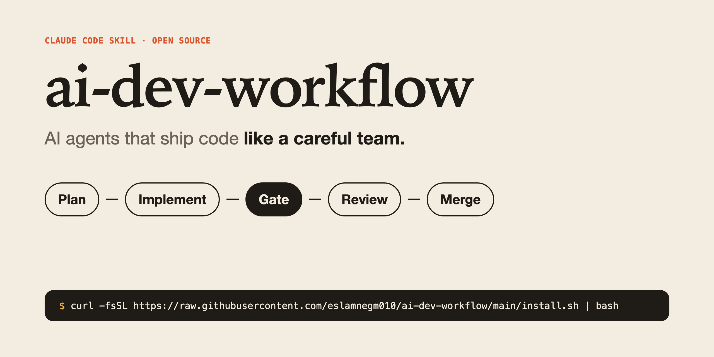
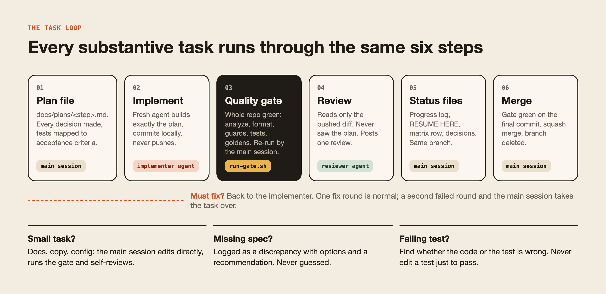
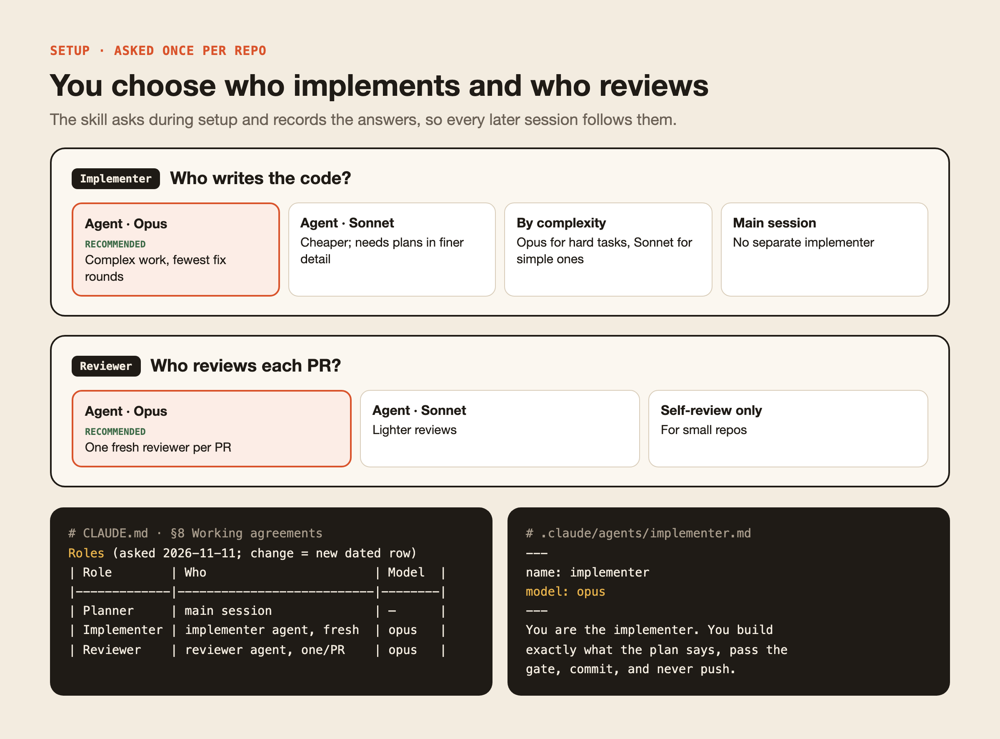
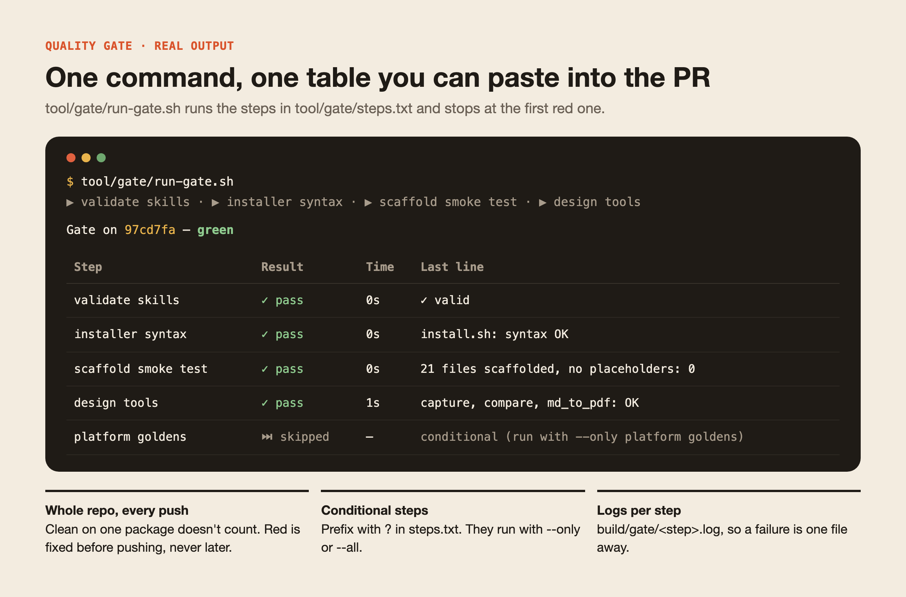
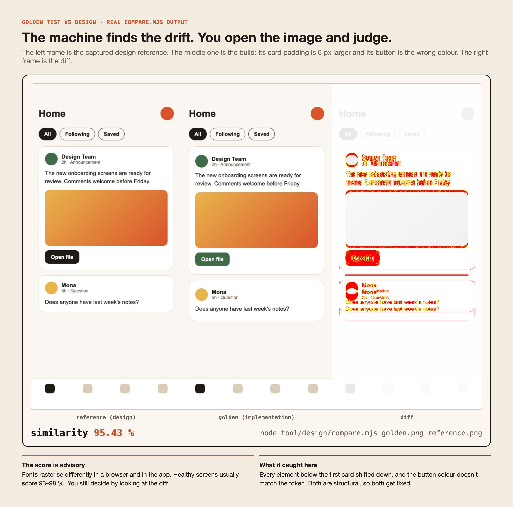
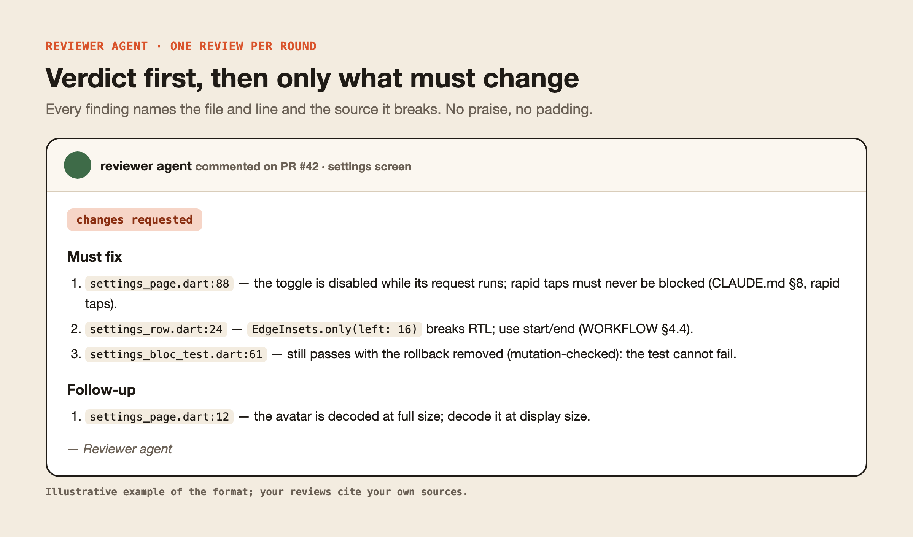
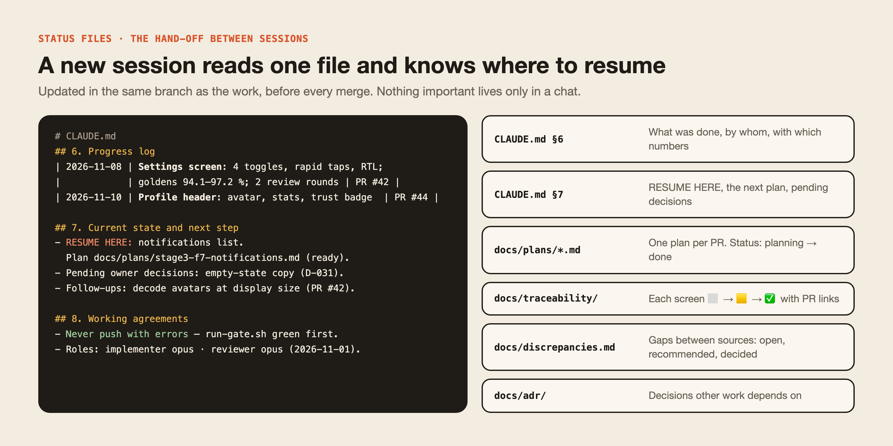

<p align="center"></p>

**A Claude Code skill that makes AI agents ship code the way a careful senior team does.** One agent plans, a
separate agent writes the code, a hard quality gate checks the whole repo, and a third agent, which never saw the
plan, reviews the pushed PR. Screens are checked pixel by pixel against the design with golden tests. Every step
is written down in the repo, so any new session can pick up exactly where the last one stopped.

```sh
curl -fsSL https://raw.githubusercontent.com/eslamnegm010/ai-dev-workflow/main/install.sh | bash
```

Then open Claude Code in any repository and say **"set up the AI dev workflow here"**.

**Contents:** [Why](#why) · [The loop](#the-loop) · [Roles](#roles-you-choose-once) · [Quality gate](#quality-gate) ·
[Golden tests](#golden-tests-against-the-design) · [Reviews](#reviews) · [Status files](#status-and-hand-off-files) ·
[Examples](#examples) · [Install](#install) · [Use it](#use-it) · [Optional modules](#optional-modules)

---

## Why

AI agents write a lot of code quickly. Without a process they also guess at missing specs, approve their own work,
"fix" failing tests by weakening them, drift from the design, and forget everything when the context is compacted.

| Problem | What the workflow does about it |
|---|---|
| The agent invents behaviour, copy or pixels | **Translate, don't invent.** Every gap is logged as a *discrepancy* with options and a recommendation. The owner decides product questions; small technical gaps are decided and marked "delegated" |
| The same agent writes and approves the code | **Three separate roles:** the planner, the implementer (a new instance for every task) and the reviewer (one per PR, reading only the pushed diff) |
| "All tests pass" when they don't | **The main session re-runs the gate itself.** The gate covers the whole repo before every push, PR and merge |
| Tests edited until they go green | **Never edit a test just to make it pass.** Key tests are *mutation-checked*: break the code, watch the test fail, restore |
| The UI drifts from the design | **Golden tests against captured design references**, in every theme and language, with diff images and similarity scores |
| A new session doesn't know where things stand | **Living status files:** a progress log, a **RESUME HERE** line and every standing rule, in the repo |
| Endless fix rounds | **Take over after the second failed round.** Another round means the hand-off failed |

## The loop

<p align="center"></p>

Every substantive task runs these six steps. Small or mechanical tasks (docs, copy, config, renames) skip the agents:
the main session makes the change, runs the gate and self-reviews against the Definition of Done. **The process
scales with the task.**

Around the loop, the skill ships the whole method: stages with exit gates (alignment → foundation → design system
→ feature loop → hardening → release), a precedence table for sources of truth, Definition of Ready and Done, PR
sizing (≤ ~800 lines, stacked slices), a pre-push checklist, and change management for a new design export, rule
changes, copy and architecture.

## Roles you choose once

<p align="center"></p>

The skill asks once per repo, then writes the answer in two places: a dated **Roles** table in `CLAUDE.md`, and the
`model:` line of each agent file. Every later session follows it. A change of mind adds a new dated row, so the
history stays visible.

- **`implementer`**: a fresh instance for every task. It builds exactly the plan, writes the tests, mutation-checks
  the ★ tests, passes the gate and commits locally. **It never pushes.**
- **`reviewer`**: one instance per PR, reused for that PR's rounds and replaced for the next PR, so it carries no
  memory. It reads `gh pr diff` against the specs and the design, and never sees the plan's reasoning.

## Quality gate

<p align="center"></p>

This is real output from running the gate on this repository. You list your steps in `tool/gate/steps.txt`; the
runner stops at the first failure, keeps a log per step, and prints a Markdown table to paste into the PR.

The guidance also covers:
- guard scripts that turn project rules into code (architecture direction, design tokens only, no hard-coded UI
  strings, translation parity);
- zero analyzer hints and coverage targets;
- a **fault ratchet**, so an existing repo can adopt a strict gate without weakening it.

## Golden tests against the design

<p align="center"></p>

This is real `compare.mjs` output on a demo screen. The build has 6 px of extra card padding and the wrong button
colour. The diff shows every shifted element in red, and the score drops to 95.43 %.

```
HTML prototype ──capture.mjs──► design/reference/<screen>/viewport.<theme>.<locale>.png   (the oracle)
component / screen ──golden test──► goldens/ci/    tolerant, runs everywhere
                                    goldens/macos/ exact, real fonts, one machine
compare.mjs ──► reference | golden | diff  +  similarity table for the PR
```

- **`capture.mjs`** screenshots every phone frame on a prototype board with Playwright. It waits for lazy frames and
  fonts, pages through scroll bodies, and writes a manifest. A small JSON config drives it.
- **Two kinds of goldens.** CI goldens are tolerant: a small pixel budget absorbs anti-aliasing differences between
  operating systems. Platform goldens are exact, use real fonts, and are the ones compared with the design. There
  is one golden per scenario (never a grid), and every component is tested in light/dark × each language, LTR and
  RTL.
- **`compare.mjs`** works on one pair, or on many pairs from a JSON file, giving a Markdown table and a similarity
  range. The score is advisory: you open the image and judge.
- **Flutter helpers** (alchemist) are included. The guide also has notes for web (Playwright), Android
  (Paparazzi/Roborazzi), iOS (swift-snapshot-testing) and React Native.

## Reviews

<p align="center"></p>

The reviewer posts **one** review per round:
- the verdict on the first line;
- numbered **Must fix** items (real defects only) and **Follow-up** items, each with `file:line` and the source it
  breaks.

It checks correctness, spec fidelity, architecture, tests that cannot fail, golden changes, comment noise and
performance. When a test is the only guard for a value, the reviewer mutates the code to prove the test can fail.

## Status and hand-off files

<p align="center"></p>

| File | Answers |
|---|---|
| `CLAUDE.md` | The living hand-off: product in 60 seconds, sources of truth, locked decisions, layout, **§6 progress log**, **§7 current state (RESUME HERE)**, **§8 working agreements and Roles**, compaction priority |
| `docs/WORKFLOW.md` | The process, adapted to the project |
| `docs/plans/<stage>-<step>.md` | One plan per PR, with its status in the header |
| `docs/adr/NNNN-*.md` | Decisions other work depends on |
| `docs/discrepancies.md` | Conflicts between sources: open, recommended or decided, and where each decision was applied |
| `docs/traceability/phase-N.md` | Per screen: references, components, states, strings, rules, acceptance criteria, ⬜/🟨/✅ |
| `docs/reference/<package>.md` | A binding reference for a key dependency, studied from its source code |
| `docs/research/*.md` | What big products do, the options and a recommendation, before a plan |

`md_to_pdf.mjs` turns any Markdown hand-off into a branded A4 PDF with a cover, contents, page numbers and
RTL-aware text.

## Examples

<details>
<summary><b>A plan file</b> (<code>docs/plans/stage3-f4-settings.md</code>, shortened)</summary>

```markdown
# Stage 3 · F4 — settings screen                 Status: in progress

> Implementer: implementer agent (opus) · Branch: feat/settings-ui · One PR.

## 2. Acceptance criteria
AC-settings-01 Given notifications are on, When the user taps the toggle five times quickly,
               Then the toggle shows each tap at once and one request is sent with the final value.
AC-settings-02 Given the request fails, Then the toggle rolls back and one snackbar appears.

## 3. Decisions (binding)
| # | Decision                               | Why                         | Source |
|---|----------------------------------------|-----------------------------|--------|
| 1 | 400 ms settle window, 1 request in flight | rapid-tap rule             | CLAUDE.md §8 |
| 2 | Row uses AppRow.toggle, no new widget  | shared, never duplicated    | design/reference/settings |

## 6. UI references
settings/viewport.{light,dark}.{en,ar}.png · new variant: AppRow.toggle (4 goldens)

## 10. Tests
| # | Case                         | Failure it would catch          | Test                          | ★ |
|---|------------------------------|---------------------------------|-------------------------------|---|
| 1 | burst of 5 taps → 1 request  | one request per tap             | settings_bloc_test "burst"    | ★ |
| 2 | burst back to start → 0      | sending an unchanged value      | settings_bloc_test "no-op"    | ★ |
| 3 | failure → rollback + 1 notice| notice for an overtaken tap     | settings_bloc_test "rollback" | ★ |
```
</details>

<details>
<summary><b>Gate steps</b> (<code>tool/gate/steps.txt</code>)</summary>

```text
# name | command — run in order from the repo root; "?" = conditional (--only <name> or --all)
codegen          | (cd app && dart run build_runner build -d)
analyze          | flutter analyze
format           | dart format --output=none --set-exit-if-changed lib test
guards           | (cd tool/guards && dart run my_guards:check_all)
tests            | flutter test --exclude-tags platform
?platform goldens| flutter test --tags platform
```
</details>

<details>
<summary><b>A discrepancy entry</b> (<code>docs/discrepancies.md</code>)</summary>

```markdown
| ID    | Found in        | Conflict                                         | Options                     | Recommendation              | Blocks   | Status |
|-------|-----------------|--------------------------------------------------|-----------------------------|-----------------------------|----------|--------|
| D-031 | settings design | Empty state for "no devices" has no copy or art  | (a) reuse generic empty view · (b) design brief | (a) now, (b) before release | settings | 🟨     |
```
</details>

<details>
<summary><b>A PR body</b> (from <code>.github/pull_request_template.md</code>)</summary>

```markdown
Plan: `docs/plans/stage3-f4-settings.md`. Implemented by implementer agent (opus); 2 review rounds.

- Settings screen: 4 toggles on AppRow.toggle, rapid taps (400 ms settle, 1 in flight), RTL.
- Decisions: D-031 (owner).
- Tests: the plan's matrix + 3 extra cases; key tests mutation-checked (M1–M6).

Gate (main session, on 3f9c2e1): analyze clean · format 0 changed · guards clean · tests 412 · platform 24.
Fidelity: settings viewport 94.1–97.2 % (light/dark × en/ar); diffs opened.
```
</details>

<details>
<summary><b>Comparing many goldens at once</b></summary>

```sh
cat > design/compare-pairs.json <<'EOF'
[
  { "name": "settings light en", "golden": "app/test/goldens/macos/settings_light_en.png",
    "reference": "design/reference/settings/viewport.light.en.png" },
  { "name": "settings dark ar",  "golden": "app/test/goldens/macos/settings_dark_ar.png",
    "reference": "design/reference/settings/viewport.dark.ar.png" }
]
EOF
node tool/design/compare.mjs --pairs design/compare-pairs.json --md build/fidelity.md
```

```
| Golden            | Similarity | Differing px | Side by side                                  |
|-------------------|------------|--------------|-----------------------------------------------|
| settings light en | 97.21 %    | 9801/351348  | build/design-compare/settings_light_en.png    |
| settings dark ar  | 94.10 %    | 20730/351348 | build/design-compare/settings_dark_ar.png     |

Range 94.1–97.2 % over 2 pairs (advisory: open the images).
```
</details>

## Install

**One line.** It clones to `~/.ai-dev-workflow` and links the skill into `~/.claude/skills`:

```sh
curl -fsSL https://raw.githubusercontent.com/eslamnegm010/ai-dev-workflow/main/install.sh | bash
```

**Or with git:**

```sh
git clone https://github.com/eslamnegm010/ai-dev-workflow.git ~/.ai-dev-workflow
~/.ai-dev-workflow/install.sh
```

**Manage it:**

```sh
~/.ai-dev-workflow/install.sh --update    # git pull and relink
~/.ai-dev-workflow/install.sh --status    # what is installed
~/.ai-dev-workflow/install.sh --remove    # uninstall
```

- `--copy` copies instead of linking.
- `--force` replaces a skill of the same name from elsewhere; the old one is moved to `~/.claude/skills-backup/`.
- `CLAUDE_SKILLS_DIR=<dir>` installs to another folder.

Start a new Claude Code session afterwards.

## Use it

### Set up a repository (once)

In Claude Code, from the repository, say *"set up the AI dev workflow here"*. The skill reads the repo, asks the role
questions, then runs the scaffold:

```sh
~/.claude/skills/ai-dev-workflow/scripts/init.sh \
  --project "My App" --implementer-model opus --reviewer-model opus \
  [--design]          # capture / compare / PDF tools + design/ folders
  [--flutter]         # Flutter golden helpers
  [--no-attribution]  # commits and PRs carry no AI attribution
```

The scaffold **never overwrites a file**. If you already have a `CLAUDE.md`, it writes `CLAUDE.workflow.md` for you
to merge. Claude then fills in the project facts, puts your real commands into `tool/gate/steps.txt`, runs every
step once, and opens the setup PR.

<details>
<summary>What the scaffold creates</summary>

```
CLAUDE.md                              living hand-off (roles filled in)
docs/WORKFLOW.md                       the process
docs/plans/_template.md                plan template
docs/adr/0000-template.md
docs/discrepancies.md
docs/traceability/phase-1.md
docs/reference/_template.md
docs/research/_template.md
.claude/agents/implementer.md          model: <your choice>
.claude/agents/reviewer.md             model: <your choice>
.claude/skills/<project>-quality-gate/SKILL.md
tool/gate/run-gate.sh + steps.txt
.github/pull_request_template.md
--design:  tool/design/{capture,compare,md_to_pdf}.mjs, package.json, design/capture.config.json, design/README.md
--flutter: tool/flutter-goldens/* (copy into each package's test/)
```
</details>

### Everyday requests

| Say | What happens |
|---|---|
| "build the settings screen" | Plan file → implementer → gate → PR → reviewer → fixes → status files → merge |
| "fix the crash on sign-out" | Sized as a small task or a full loop, depending on risk |
| "review PR 42" | A fresh reviewer posts one review on the PR |
| "capture the design references" | `capture.mjs` runs from `design/capture.config.json` |
| "compare the settings goldens with the design" | `compare.mjs --pairs …` gives a similarity table and diff images |
| "where did we stop?" | Claude reads `CLAUDE.md` §7, **RESUME HERE** |
| "make a PDF of the API hand-off" | `md_to_pdf.mjs` runs with your brand and footer |

### Design tools

```sh
cd tool/design && npm install && npx playwright install chromium
npm run capture                                   # every frame on the board
npm run capture -- home settings                  # only these screens
npm run compare -- <golden.png> <reference.png>   # one pair
npm run pdf -- ../../docs/handoff.md ../../docs/Handoff.pdf --brand "My App" --footer "For partners"
```

## Optional modules

These are used only when needed, or when you ask for them:

- **`optional/backend-contract/`**, for when the backend doesn't exist yet. It adds an API schema written before the
  client, example responses validated against it, an optional local stand-in, and a backend hand-off doc with a PDF.
- **`optional/gemini/`**, for using Gemini as an external implementer through Antigravity CLI. It runs in an isolated
  git worktree with a live Terminal view, and fix rounds resume the same conversation. The `reviewer` agent still
  reviews every PR.

## Requirements

- [Claude Code](https://claude.com/claude-code), `git`, and [`gh`](https://cli.github.com) (signed in) for PRs and
  reviews.
- Node 18+ for the design tools; Playwright installs its own Chromium.
- For the Flutter helpers: Flutter with [`alchemist`](https://pub.dev/packages/alchemist).
- For the optional Gemini module: Antigravity CLI (`agy`).
- Written for macOS; it should run on Linux. Windows needs WSL.

## Repository layout

```
install.sh                      installer (curl | bash, --update, --status, --remove, --copy, --force)
scripts/validate.sh             front matter and script syntax checks
docs/images/                    README images (sources and renderer in docs/images/src)
skills/ai-dev-workflow/
  SKILL.md                      entry point: modes, setup, task loop, non-negotiables
  references/                   workflow · roles-and-agents · quality-gate · golden-tests · handoff-and-docs · reporting
  templates/                    CLAUDE.md · agents/ · docs/ · gate · design
  scripts/                      init.sh · gate/run-gate.sh · design/*.mjs · flutter-goldens/
  optional/                     backend-contract/ · gemini/
```

## Contributing

Issues and PRs are welcome. Run `scripts/validate.sh` before pushing. Keep the skill general: no project names, no
private paths, nothing tied to one stack except clearly marked helpers. To change a README image, edit its HTML in
`docs/images/src/` and run `node render.mjs` there (Playwright needed).

## License

[MIT](LICENSE)
